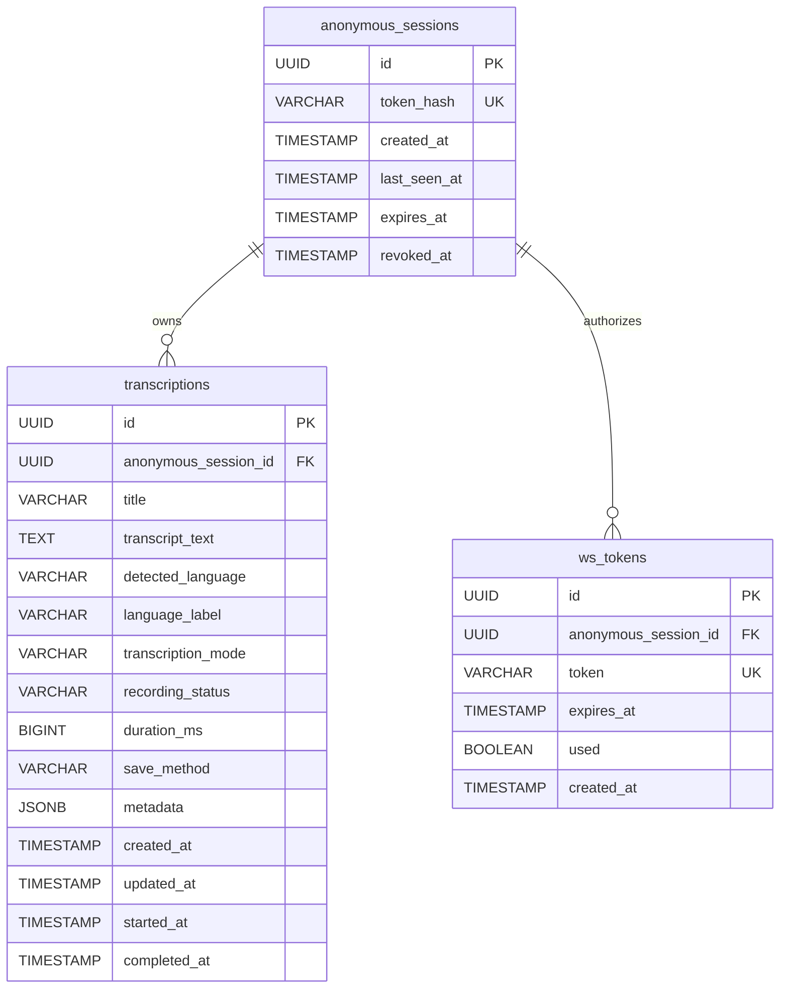

# SpeechFlow — Database Design (Supabase PostgreSQL)

## Overview
SpeechFlow uses Supabase PostgreSQL as its persistent storage layer. All access is performed asynchronously through the FastAPI backend via SQLAlchemy 2.x and `asyncpg`.

## Connection Configuration
- **Supabase Session Pooler**: Port 5432 is recommended for long-lived backend Web Services on Render.
- **Supabase Transaction Pooler**: Port 6543 requires `NullPool` and `connect_args={"prepared_statement_cache_size": 0}` to prevent duplicate prepared statement collisions.

## Entity Relationship Diagram

## Tables & Indexes
- `anonymous_sessions`: Primary key UUID, unique index on `token_hash`.
- `ws_tokens`: Primary key UUID, foreign key to `anonymous_sessions.id` (CASCADE), index on `token` and `expires_at`.
- `transcriptions`: Primary key UUID, foreign key to `anonymous_sessions.id` (CASCADE), indexes on `anonymous_session_id`, `(anonymous_session_id, created_at DESC)`, and `recording_status`.
